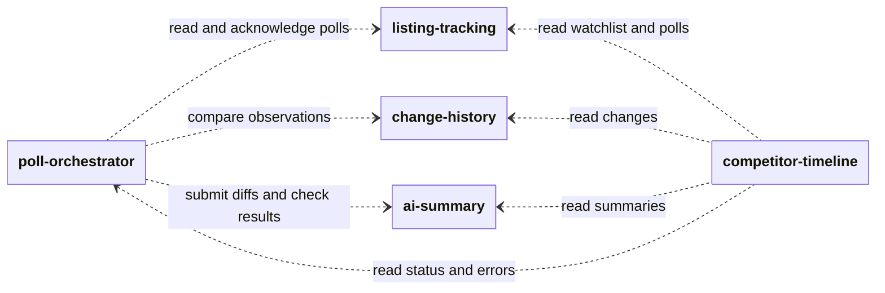

# CompetitorPulse

CompetitorPulse polls product listings, records changes to their content and availability, and asks an LLM to explain each change. The watchlist and timeline use a NestJS API backed by PostgreSQL.

## Start locally with Docker Compose

Run the commands from the repository root, next to `compose.yaml`. Compose reads the root `.env`, and exported shell variables take precedence. On a fresh checkout, create the file from the [example](./.env.example).

```sh
test -f .env || cp .env.example .env
```

### Set the listing source and AI provider

The root example is ready to use with the bundled listing source at `http://listing-source:4002` and the mock LLM. For an existing Docker volume, keep the `DB_DATABASE` value used when it was initialized. For a host-run backend, use the [backend environment example](./backend/.env.example).

Choose one AI configuration in the same file.

- **Bundled mock LLM.** Leave `AI_API_KEY`, `AI_BASE_URL` and `AI_MODEL` commented out, as in the example file. Compose runs the mock locally and its summaries begin with “Mock AI summary”.
- **DeepSeek directly.** Set `AI_API_KEY` to a DeepSeek key and leave `AI_BASE_URL` and `AI_MODEL` commented out. The backend uses `deepseek-flash` at `https://api.deepseek.com`. If you set that URL explicitly and leave the key blank, the summary is marked `failed` and uses zero calls.
- **OpenRouter.** Set the three entries below to use DeepSeek Flash through OpenRouter. If the root `.env` already defines `OPENROUTER_API_KEY`, replace the existing `AI_API_KEY` assignment with `AI_API_KEY=${OPENROUTER_API_KEY}` and place it below the OpenRouter key.

```dotenv
AI_API_KEY=your-openrouter-api-key
AI_BASE_URL=https://openrouter.ai/api/v1
AI_MODEL=deepseek/deepseek-v4.1-flash-1017
```

### Launch the stack

```sh
docker compose up -d --build
```

Add `acme-crm` to the watchlist to start its first poll. The frontend listens on port 5173, the API on 3000, the listing source on 4002, the mock LLM on 4001 and PostgreSQL on 5432. Compose creates the database volume on first use and the API applies its migrations at startup. [Open the watchlist](http://localhost:5173)

After saving the AI settings and the container-reachable listing URL in the root `.env`, recreate the backend to apply them. New summaries use the selected provider. Historical summaries keep their saved text.

```sh
docker compose up -d --no-deps backend
```

Use `docker compose down` to stop the stack and preserve its database volume.

On a competitor’s timeline, **Poll now** requests a fetch and refreshes the timeline when it finishes. A queued poll, an active fetch and a scheduled retry each count as unfinished work, so repeated requests follow the same poll. To observe a new mock version, click **Advance mock listing** and then **Poll now**.

On the watchlist, **Reset all** clears all tracked IDs, poll history, changes and AI summaries after confirmation. It returns the listing simulator to its first versions and restores both mock servers’ settings and counters. Calls already reserved for a live AI provider still count toward the current UTC day’s cap.

## Other configuration

| Setting | Behavior |
| --- | --- |
| `LISTING_SOURCE_URL` | To switch sources, set this to the new server’s base URL in the root `.env` and recreate the backend. For a source running on the Docker Desktop host, use `http://host.docker.internal:4002` with the port that source listens on. |
| `POLL_INTERVAL_MS` | Defaults to 900000. Set to 5000 for a faster local demonstration. |
| `POLL_TIMEOUT_MS` | Maximum duration of a listing request in milliseconds. Defaults to `10000`. |
| `POLL_CONCURRENCY` | Maximum number of simultaneous listing requests. Defaults to `8`. |
| `AI_BASE_URL`, `AI_MODEL`, `AI_API_KEY` | For another Chat Completions-compatible provider, use its base URL, model ID and optional bearer token. The client appends `/chat/completions` to the base URL. |
| `DEMO_RESET_ENABLED` | Enables the destructive local reset control. Defaults to true in the local Compose stack and in development. |

## Backend architecture

The NestJS backend runs its HTTP handlers and background workers in one process. Listing Tracking, Change History, and AI Summary each own their data and operate independently. Each arrow points from the importing module to its direct dependency. [Module source](./backend/src/modules)



- `poll-orchestrator` coordinates work by poll ID. Every five seconds by default, it picks up complete listings and confirmed 404s, asks `change-history` to compare them, and submits recorded changes to `ai-summary`. It tracks comparison and summary progress.
- `listing-tracking` manages watchlist additions and removals and schedules source fetches. It stores each poll's outcome and retry history, including failed fetches.
- `change-history` compares each observation with the competitor's last known listing. It records each comparison decision and saves a diff when the listing's content or availability changes.
- `ai-summary` turns a recorded diff into a short explanation. Its worker builds the LLM prompt, handles timeouts and retries within the daily call limit, and stores the summary or failure status under the poll ID.
- `competitor-timeline` serves the React watchlist and timeline. It flags competitors that changed in the last 24 hours and joins observations, diffs, and summaries by poll ID. It reads the orchestrator's status to show pending comparisons and active errors.

**All polls** includes failed fetches. **Changes** can show a recorded diff while its summary is pending or unavailable.

## Design decisions

- Listing Tracking writes one UUIDv7 log per scheduled poll. Up to three HTTP attempts share the ID. The finished row holds the observed listing fields or a confirmed 404 or failure, alongside its prior errors. Removing a competitor stops future polling and preserves its history.
- With 6,000 competitors and five requests per second, a full sweep takes at least 20 minutes. The scheduler serves the oldest due competitor first, spaces request starts, and applies a source-wide cooldown on HTTP 429. A 15-minute sweep would require additional source capacity.
- Change history compares title, tagline, description, price and availability. The first complete listing establishes a baseline. An initial 404 leaves the ID tracked. Disappearance and return after a known listing each produce a change. A failed or partial fetch preserves the previous baseline.
- AI Summary builds the messages and stores each FIFO job and result in one PostgreSQL row. Each provider request allows up to 128 output tokens and reserves one of 2,000 calls per UTC day. A transient failure gets one retry. If quota runs out, the diff remains available with a `budget_exhausted` summary status.
- History is retained indefinitely for the assessment, covering the 90-day requirement. The local deployment uses a single source scheduler. A separate message broker, automated retention and cloud deployment are outside this implementation.
- OpenAI Codex assisted with planning, implementation and tests. During design review, the project author replaced a separate AI job table and result acknowledgment with a single durable result row keyed by poll ID.

For API details and test commands, see the [backend guide](./backend/README.md).

## Code formatting

Run `npm run format` from either `backend/` or `frontend/` to apply ESLint fixes and Prettier. To check the code without editing it, run `npm run lint` and `npm run format:check` in each directory.

Both apps use an 88-column wrapping target, braces around control flow, one variable per declaration, and blank lines between class members. Nest member decorators go on separate lines, and JSX attributes are formatted one per line when an element has multiple attributes.
