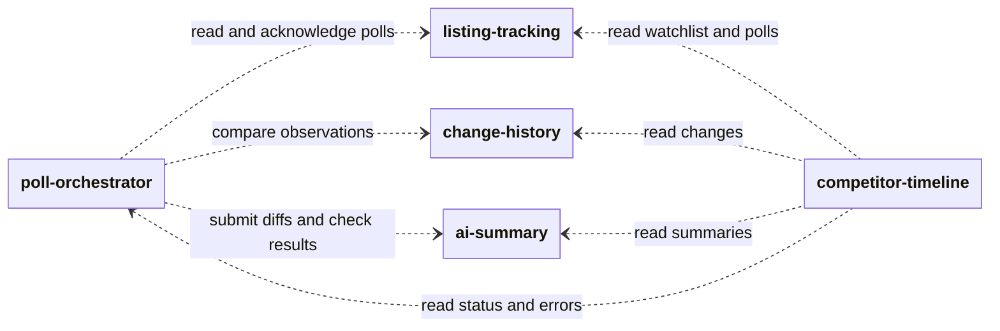

# CompetitorPulse backend

## Local development

With Docker running and nvm installed, run these commands from the repository root.

```sh
cd backend
nvm install
npm ci
test -f .env || cp .env.example .env
npm run docker:up
npm run start:dev
```

Open [the competitors endpoint](http://localhost:3000/api/competitors) to check that the API is running.

## Environment variables

When running Nest locally, edit `backend/.env` and restart Nest to apply changes. Exported shell variables take precedence. The launch commands above copy the [backend environment example](./.env.example) on first use.

```dotenv
PORT=3000
NODE_ENV=development
IS_LOCAL_ENV=true

DB_HOST=localhost
DB_PORT=5432
DB_USER=postgres
DB_PASSWORD=postgres
DB_DATABASE=competitor_pulse

LISTING_SOURCE_URL=http://localhost:4002
POLL_INTERVAL_MS=900000
POLL_TIMEOUT_MS=10000
POLL_CONCURRENCY=8
```

`POLL_INTERVAL_MS` sets how often each competitor is due for a poll. Set it to `5000` for a faster demo. `POLL_TIMEOUT_MS` limits the duration of a single fetch, and `POLL_CONCURRENCY` limits simultaneous fetches.

### AI provider

| Provider | Settings in `backend/.env` |
| --- | --- |
| Bundled mock | Leave `AI_API_KEY`, `AI_BASE_URL`, and `AI_MODEL` unset. Nest uses `http://localhost:4001/v1`. |
| DeepSeek | Set only `AI_API_KEY` to your DeepSeek key. Nest uses `deepseek-flash` at `https://api.deepseek.com`. |
| OpenRouter | Set `AI_BASE_URL=https://openrouter.ai/api/v1`, `AI_MODEL=deepseek/deepseek-v4.1-flash-1017`, and `AI_API_KEY` to your OpenRouter key. |
| Other Chat Completions provider | Set `AI_BASE_URL` and `AI_MODEL`. Set `AI_API_KEY` if the provider requires a bearer token. Nest appends `/chat/completions` to the base URL. |

### Optional settings

| Variable | Local behavior |
| --- | --- |
| `ORCHESTRATOR_INTERVAL_MS` | Target interval between passes that process finished polls. Defaults to `5000`. |
| `DEMO_RESET_ENABLED` | Enables the local reset endpoint. Defaults to `true` in development. |
| `MOCK_SOURCE_TARGET`, `MOCK_LLM_TARGET` | Mock server addresses for demo resets. Default to `http://localhost:4002` and `http://localhost:4001`, respectively. |
| `LOG_LEVEL` | Overrides the logging level. Defaults to `debug` when `IS_LOCAL_ENV=true` and `info` otherwise. |

When running the full stack with Docker Compose, configure the repository-root `.env`. Use `LISTING_SOURCE_URL=http://listing-source:4002` for the bundled source. [Full-stack launch instructions](../README.md#start-locally-with-docker-compose)

## Backend architecture

The NestJS backend runs its HTTP handlers and background workers in one process. Listing Tracking, Change History, and AI Summary each own their data and operate independently. Each arrow points from the importing module to its direct dependency. [Module source](./src/modules)



- `poll-orchestrator` coordinates work by poll ID. Every five seconds by default, it picks up complete listings and confirmed 404s, asks `change-history` to compare them, and submits recorded changes to `ai-summary`. It tracks comparison and summary progress.
- `listing-tracking` manages watchlist additions and removals and schedules source fetches. It stores each poll's outcome and retry history, including failed fetches.
- `change-history` compares each observation with the competitor's last known listing. It records each comparison decision and saves a diff when the listing's content or availability changes.
- `ai-summary` turns a recorded diff into a short explanation. Its worker builds the LLM prompt, handles timeouts and retries within the daily call limit, and stores the summary or failure status under the poll ID.
- `competitor-timeline` serves the React watchlist and timeline. It flags competitors that changed in the last 24 hours and joins observations, diffs, and summaries by poll ID. It reads the orchestrator's status to show pending comparisons and active errors.

**All polls** includes failed fetches. **Changes** can show a recorded diff while its summary is pending or unavailable.

## Design decisions

- Listing Tracking writes one UUIDv7 log per scheduled poll. Up to three HTTP attempts share the ID. The finished row holds the observed listing fields or a confirmed 404 or failure, alongside its prior errors. Removing a competitor stops future polling and preserves its history.
- With 6,000 competitors and five requests per second, a full sweep takes at least 20 minutes. The scheduler serves the oldest due competitor first, spaces request starts, and applies a source-wide cooldown on HTTP 429. A 15-minute sweep would require additional source capacity.
- Change history compares title, tagline, description, price and availability. The first complete listing establishes a baseline. An initial 404 leaves the ID tracked. Disappearance and return after a known listing each produce a change. A failed or partial fetch preserves the previous baseline.
- AI Summary builds the messages and stores each FIFO job and result in one PostgreSQL row. Each provider attempt reserves a slot against a shared limit of 2,000 per UTC day. A transient failure gets one retry. If quota runs out, the diff remains available with a `budget_exhausted` summary status.
- History is retained indefinitely for the assessment, covering the 90-day requirement. The local deployment uses a single source scheduler. A separate message broker, automated retention and cloud deployment are outside this implementation.
- OpenAI Codex assisted with planning, implementation and tests. During design review, the project author replaced a separate AI job table and result acknowledgment with a single durable result row keyed by poll ID.

For API details and test commands, see the [end-to-end API guide](./test/e2e/README.md).

## Code formatting

Run `npm run format` from either `backend/` or `frontend/` to apply ESLint fixes and Prettier. To check the code without editing it, run `npm run lint` and `npm run format:check` in each directory.

Both apps use an 88-column wrapping target, braces around control flow, one variable per declaration, and blank lines between class members. Nest member decorators go on separate lines, and JSX attributes are formatted one per line when an element has multiple attributes.
