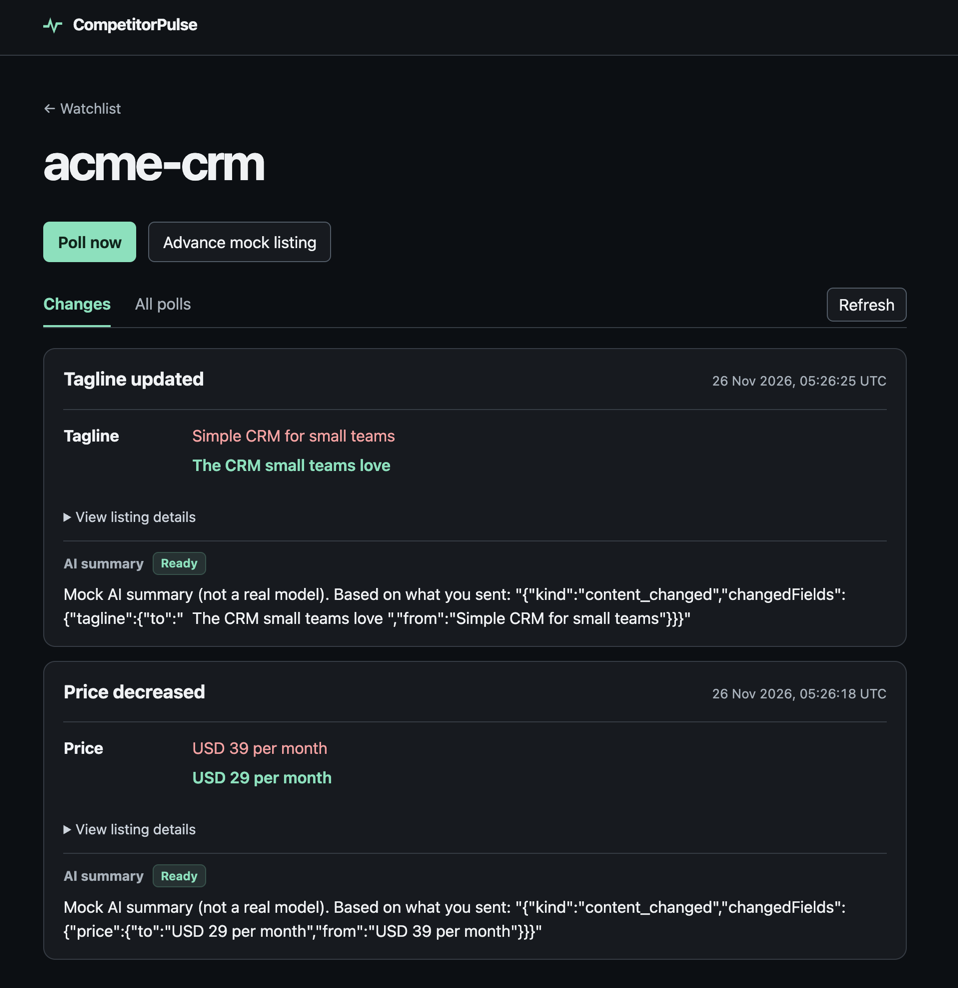
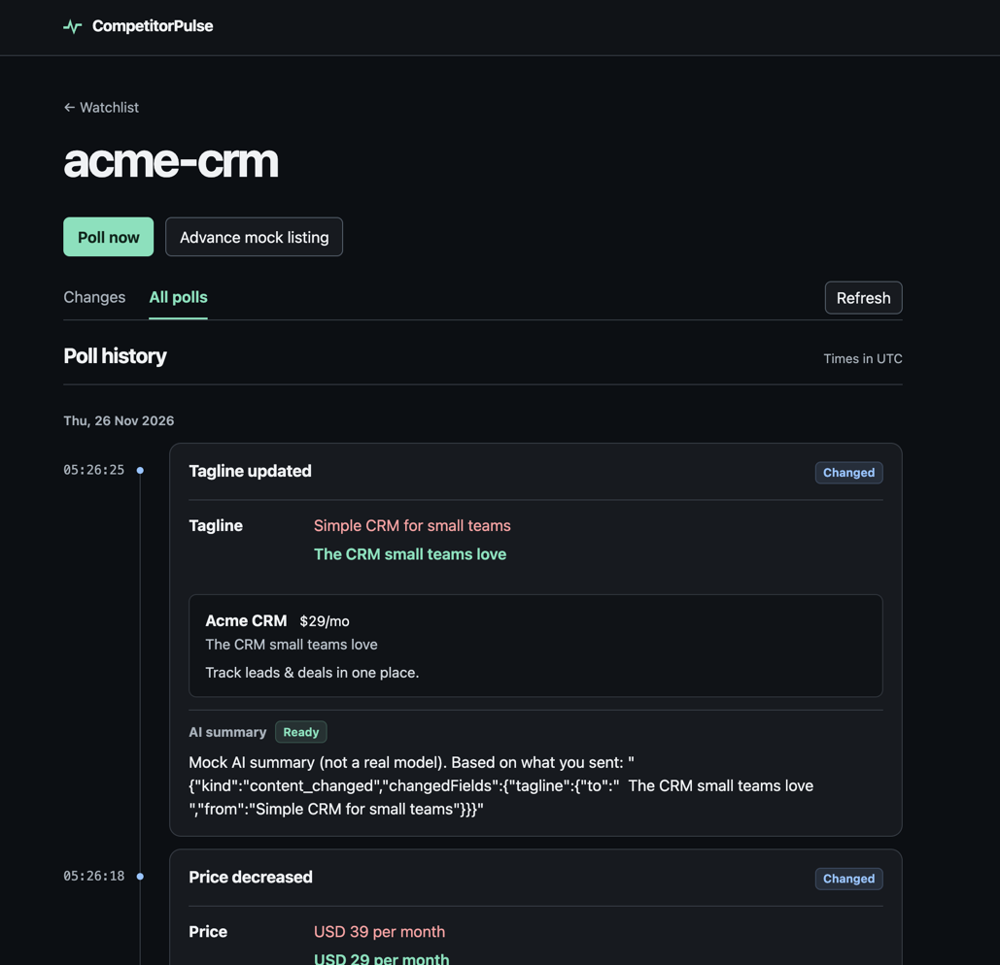
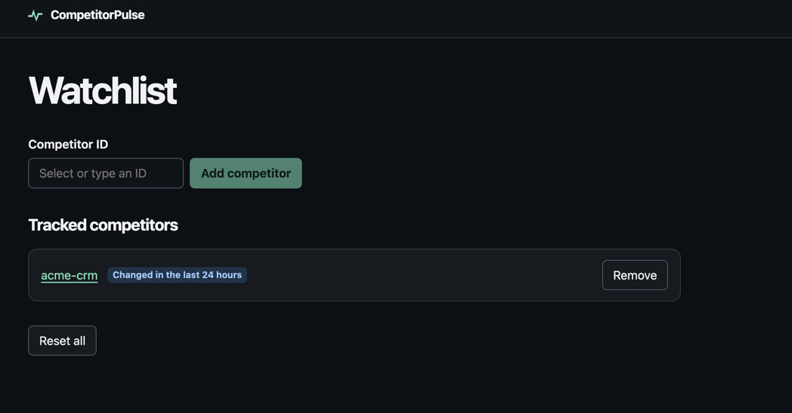

# UI

## Changes tab

Compare the previous and current listing values and read the AI summary when it’s available.

## All polls tab

Review every completed check in time order, newest first, including failed requests and checks where the listing stayed the same.

## Main page (Watchlist)

Add or remove competitors by ID, see which listings changed in the last 24 hours, and select a competitor to open its timeline.

