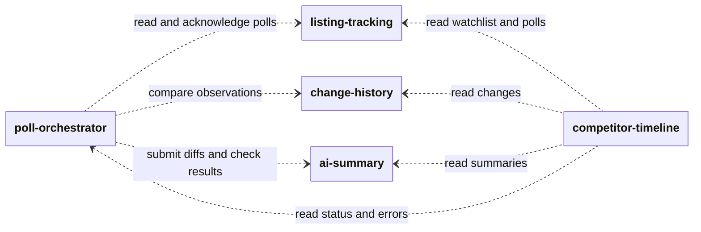

# CompetitorPulse architecture

## Design decisions

1. **Independent leaf modules.** I split the workflow into three modules. Listing Tracking fetches and stores poll results, Change History detects meaningful changes, and AI Summary explains them. Each owns its data, so a slow LLM can delay a summary while source polling continues.
2. **The orchestrator coordinates the handoffs.** It passes each complete listing or confirmed 404 from Listing Tracking to Change History. If Change History records a change, the orchestrator sends the diff to AI Summary.
3. **Each stage saves its result under the same poll ID.** If the backend stops after recording a change but before queuing its summary, the orchestrator resumes from the saved change. The same poll can finish processing without another source request or a duplicate change.

## Alternative considered

I considered connecting the three stages through a dedicated message queue.

`listing-tracking` → `change-history` → `ai-summary`

Listing Tracking would publish each observation. Change History would consume it and publish an event for AI Summary only when it detected a change.

I chose a dedicated `poll-orchestrator` to keep the infrastructure footprint small. PostgreSQL can handle the expected workload, so the orchestrator polls it for pending work without adding a separate queue service.

The module boundaries also leave a path to queues later. Queue consumers could call the same services, preserve observation order per competitor, and carry the existing poll ID so a redelivered event can reuse its saved result.

## Backend architecture

The NestJS backend runs its HTTP handlers and background workers in one process. Listing Tracking, Change History, and AI Summary each own their data and operate independently. Each arrow points from the importing module to its direct dependency. [Module source](../backend/src/modules)

- `poll-orchestrator` coordinates work by poll ID. Every five seconds by default, it picks up complete listings and confirmed 404s, asks `change-history` to compare them, and submits recorded changes to `ai-summary`. It tracks comparison and summary progress.
- `listing-tracking` manages watchlist additions and removals and schedules source fetches. It stores each poll's outcome and retry history, including failed fetches.
- `change-history` compares title, tagline, description, and price against the last complete listing. Failed or partial fetches preserve that baseline. Unknown IDs stay tracked after a 404. A known listing disappearing or returning counts as a change.
- `ai-summary` turns a recorded diff into a short explanation. Its worker builds the LLM prompt, handles timeouts and retries within the daily call limit, and stores the summary or failure status under the poll ID.
- `competitor-timeline` serves the React watchlist and timeline. It flags competitors that changed in the last 24 hours and joins observations, diffs, and summaries by poll ID. It reads the orchestrator's status to show pending comparisons and active errors.

### Competitor timeline

The React watchlist and timeline read from the NestJS API. Each snapshot reports the source outcome in `outcomeKind` and the AI result in `summaryStatus`. [Snapshot contract](../backend/src/modules/competitor-timeline/dto/snapshot.dto.ts)

**All polls** includes failed fetches. **Changes** can show a recorded diff while its summary is pending or unavailable.

## Operating limits

- **Polling.** At five requests per second, 6,000 competitors take at least 20 minutes. The scheduler polls the oldest due first and honors `Retry-After` across all IDs. A 15-minute sweep requires more source capacity.
- **AI budget.** Each LLM attempt, including a retry, counts toward 2,000 calls per UTC day. The timeline keeps the change even if the summary fails or the budget runs out.
- **Retention.** PostgreSQL keeps every poll indefinitely, including unchanged and failed checks. I left automated cleanup and cloud deployment out of the assessment.
